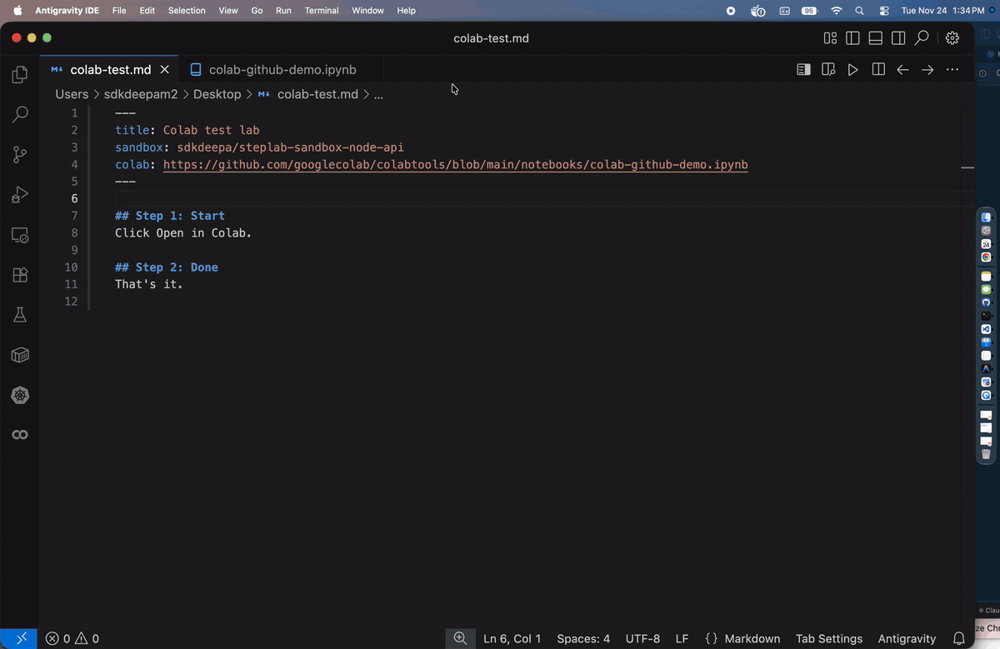
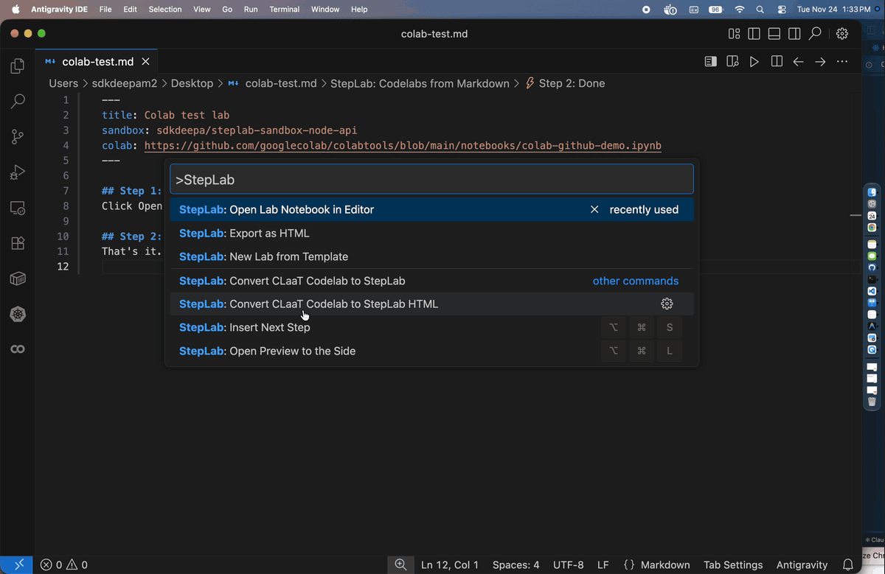

# StepLab for VS Code and Antigravity

Write a step-by-step codelab in **one markdown file** and see it as an interactive lab while you type. Free and open source.

- [Website](https://steplab.dev)
- [Bug report](https://github.com/sdkdeepa/steplab/issues/new?labels=bug)
- [Feature request](https://github.com/sdkdeepa/steplab/issues/new?labels=enhancement)

## Quick Start



1. Install StepLab from the [Visual Studio Marketplace](https://marketplace.visualstudio.com/items?itemName=sdkdeepa.steplab) or [Open VSX](https://open-vsx.org/extension/sdkdeepa/steplab).
2. Open your lab's `.md` file, or run `StepLab: New Lab from Template` to start a new one.
3. Click ▶ in the editor title bar. Your lab opens beside the file and updates as you edit.
4. Run `StepLab: Export as HTML`. You get one file to share or host anywhere.

**Have an old CLaaT codelab?** Right-click its `.md` or `index.html` and choose `StepLab: Convert CLaaT Codelab to StepLab HTML`. To edit it first, choose `StepLab: Convert CLaaT Codelab to StepLab` instead and continue from step 3.

**Only have the HTML you exported?** Right-click it and choose `StepLab: Reopen Downloaded HTML for Editing`. StepLab saves the lab's `.md` and its images next to it and opens the preview, so you can keep editing. Works for labs exported from the editor or the website.

## Run the lab's notebook with Colab



1. Add `colab:` with a GitHub notebook link to your lab's front matter.
2. Click **Open in editor** in the preview, or run `StepLab: Open Lab Notebook in Editor`. StepLab saves the notebook next to your lab and opens it. If you already have a copy, it asks before replacing it.
3. Install Google's [Colab extension](https://marketplace.visualstudio.com/items?itemName=google.colab) (also on [Open VSX](https://open-vsx.org/extension/google/colab)).
4. Click `Select Kernel` > `Colab` > `Auto Connect`, and sign in with Google when asked.

## Commands

Open the Command Palette with `Ctrl+Shift+P`, or `Cmd+Shift+P` on Mac.

| Command | What it does |
| --- | --- |
| `StepLab: New Lab from Template` | Opens a new lab that shows every feature. |
| `StepLab: Open Preview to the Side` | Shows the lab beside your file (`Cmd+Alt+L` / `Ctrl+Alt+L`). |
| `StepLab: Insert Next Step` | Adds `## Step N:` with the right number (`Cmd+Alt+S` / `Ctrl+Alt+S`). |
| `StepLab: Export as HTML` | Saves the lab as one HTML file, images included. |
| `StepLab: Reopen Downloaded HTML for Editing` | Turns a StepLab `.html` back into an editable `.md`, with its images. |
| `StepLab: Open Lab Notebook in Editor` | Saves the lab's `colab:` notebook next to the lab and opens it here. |
| `StepLab: Convert CLaaT Codelab to StepLab` | Turns a CLaaT codelab into an editable StepLab `.md`. |
| `StepLab: Convert CLaaT Codelab to StepLab HTML` | Turns a CLaaT codelab straight into a StepLab HTML page. |

## Features

- **Live preview beside your file.** Steps, progress, time left, copyable code, callouts, slides with arrow buttons, YouTube videos, and the "Congratulations!" pop-up at the end. It follows your editor's light or dark theme.
- **Follows your cursor.** Move into `## Step 3` and the preview shows Step 3. Click a step in the preview and the editor jumps to it.
- **Export as HTML.** Saves one self-contained file, with images packed in, that you can host anywhere or send to attendees.
- **New Lab from Template.** Opens a lab that demonstrates every feature.
- **Insert Next Step** (`Ctrl+Alt+S` / `Cmd+Alt+S`) adds `## Step N:` with the right number.
- **Snippets:** `steplab` (new lab), `step0`, `step`, `slides`, `youtube`, `note`, `tip`, `warning`. In markdown files, type the name and press `Ctrl+Space` to see them (markdown hides suggestions by default).
- **Bring your CLaaT codelabs.** Works with a CLaaT `.md` or an exported CLaaT folder (`index.html` + `img/`). **StepLab: Convert CLaaT Codelab to StepLab HTML** gives you the finished StepLab page in one step; **StepLab: Convert CLaaT Codelab to StepLab** gives you an editable `.steplab.md`. Both are on the right-click menu of `.md` and `.html` files, and StepLab offers them when you open a CLaaT codelab. Your original files are never changed.
- **Launch sandbox button.** Add `sandbox: your-name/your-repo` to the front matter and the lab gets a button that opens that GitHub repo in Codespaces, a ready-to-use coding environment in the browser. It also appears in exported HTML.
- **Open in Colab button.** Add `colab:` with a notebook link (GitHub or Google Drive) and the lab gets a button that opens it in Google Colab, where each attendee gets their own copy. It also appears in exported HTML.
- **Run the notebook in your editor.** If the `colab:` notebook is on GitHub, **Open in editor** saves a copy as `notebooks/<name>.ipynb` next to your lab and opens it here. Run it with Google's [Colab extension](https://marketplace.visualstudio.com/items?itemName=google.colab) (free Colab servers, also on Open VSX) or any Jupyter kernel. StepLab never replaces your copy without asking.
- **Warnings** for out-of-order step numbers and image paths that don't exist.
- **Step outline** in the Outline view and Go to Symbol (`Ctrl+Shift+O` / `Cmd+Shift+O`).

## The format

~~~markdown
---
title: Build your first chatbot
author: Your Name
---

## Step 0: Overview
Duration: 2

What you'll build.

## Step 1: Set up
Duration: 5

```bash
pip install flask
```
~~~

Open the preview with the ▶ button in the editor title bar, or `Ctrl+Alt+L` / `Cmd+Alt+L`.

## Also on the web

Labs written here also work at [steplab.dev](https://steplab.dev), and in the [Docker image](https://github.com/sdkdeepa/steplab#run-it-with-docker).

## Data and privacy

StepLab doesn't collect any usage data. It goes online only for what your lab asks for (YouTube videos and embedded slides in the preview) and when you download a lab's notebook from GitHub.

Created by Deepa Subramanian · MIT licensed
